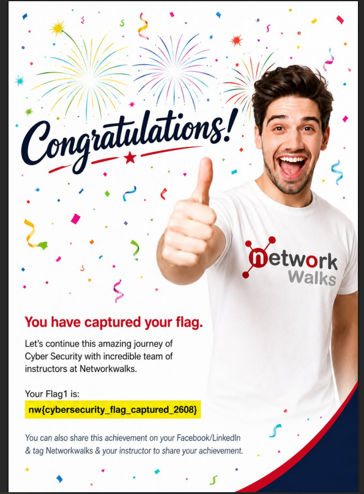

# PDF Password Cracking Lab (Networkwalks Academy)

## Overview
This report documents two distinct workflows for extracting and cracking password-protected PDF hashes using both local Kali Linux utilities and browser-based auditing tools.

---

## Method 1: Online Hash Extraction + John the Ripper (Johnny GUI)

### Workflow
1. **Hash Extraction:** Uploaded the target PDF to [OnlineHashCrack's PDF Hash Extractor](https://onlinehashcrack.com) to retrieve the `$pdf$` hash string.
2. **File Preparation:** Copied the extracted hash into a local `.txt` file on Kali Linux.
3. **Password Cracking:** Loaded the hash file into **Johnny** (GUI for John the Ripper) and executed a dictionary attack to recover the plaintext password.
4. **Verification:** Unlocked the target PDF to retrieve the flag.

### Captured Flag
* **Flag:** `nw{networkwalks_flag1_jtr_270521_1}`
* **Proof:**

---

## Method 2: Browser-Based Extraction & Dictionary Attack

### Workflow
1. **Local Browser Hash Extraction:** Used the [Networkwalks Hash Calculator](https://networkwalks.com) to parse the PDF locally in the browser and extract the `$pdf$` hash.
2. **Dictionary Attack:** Pasted the extracted hash into the [Networkwalks Password Cracker](https://networkwalks.com) and ran an attack using the built-in wordlist.
3. **Verification:** Used the cracked password to open the PDF and verify the flag.

### Captured Flag
* **Flag:** `nw{cybersecurity_flag_captured_2608}`
* **Proof:**

---

## Key Security Takeaways & Remediation
* **Enforce Strong Passphrases:** Standard dictionary words and short passwords are vulnerable to rapid offline and browser-based dictionary attacks. Use passphrases of 14+ characters.
* **Data Privacy in Audits:** Avoid uploading sensitive or proprietary documents to third-party online hash extractors; always use offline tools (`pdf2john.py`) for confidential files.
