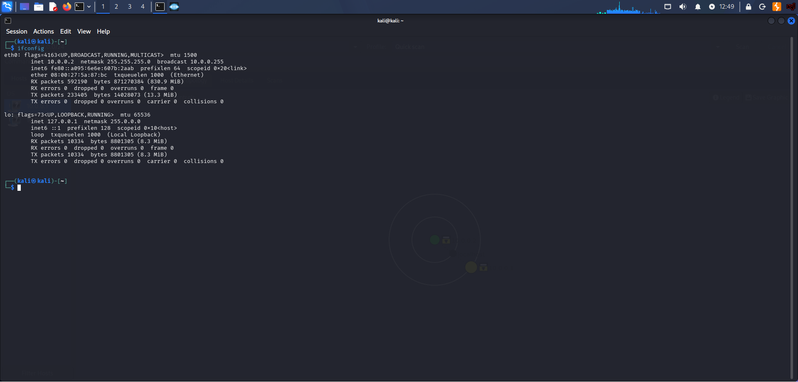
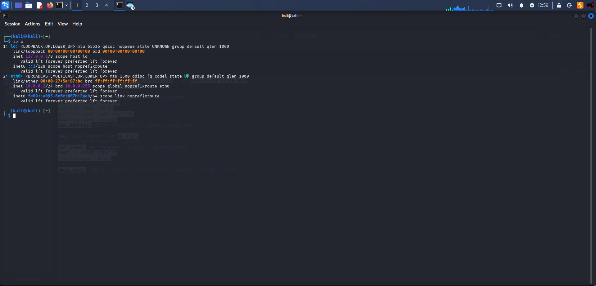
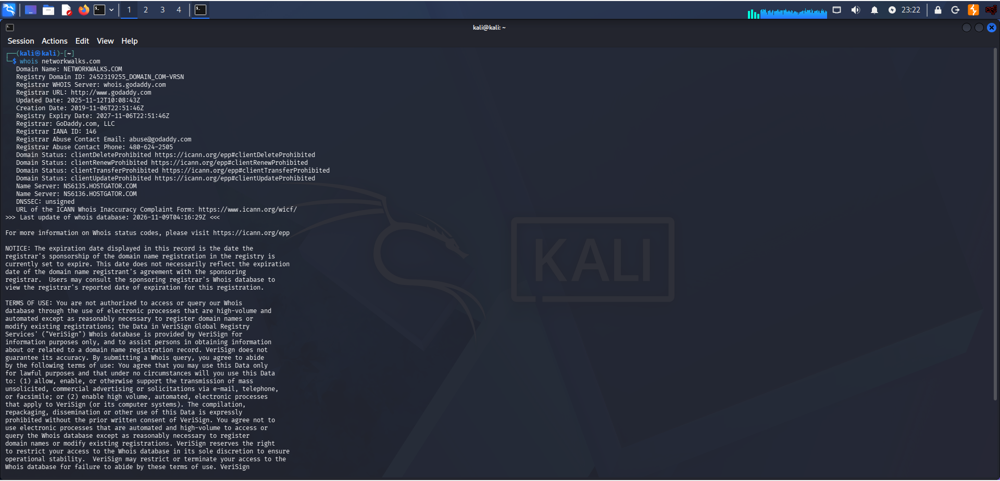
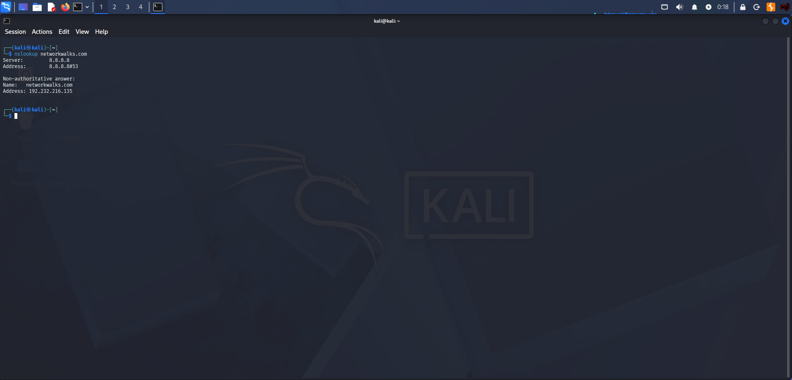
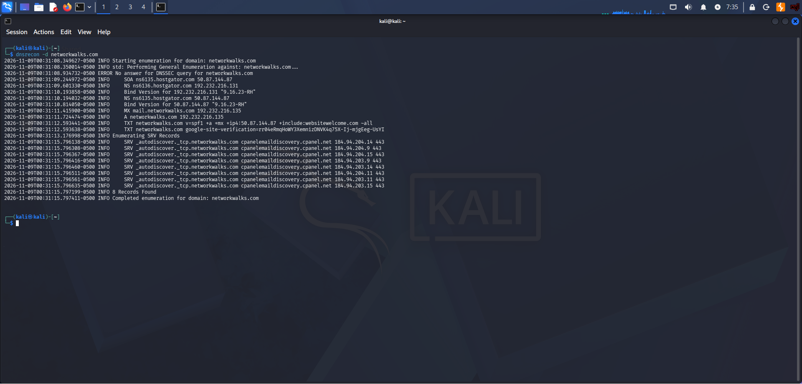
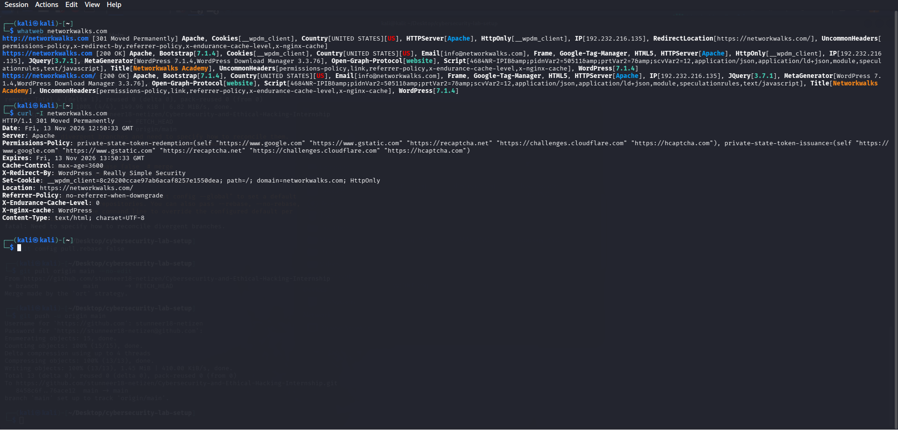
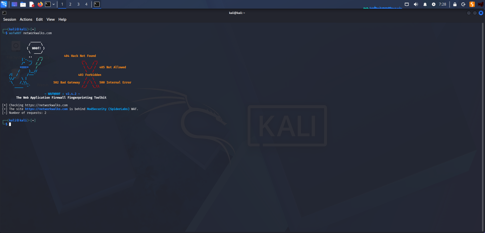

# 🔍 Footprinting, Reconnaissance, and Network Scanning Report

| Assessment Metadata | Details |
| :--- | :--- |
| **Reference No.** | `NW-LOA-B082-017` |
| **Submission Date** | 13 November 2026 |
| **Prepared By** | Siphiwe Toise |
| **Program / Batch** | Batch B084 — Networkwalks Cybersecurity Internship |
| **Client / Target Owner** | Networkwalks (Authorized by Sonia John, Managing Director) |

---

## 📑 Table of Contents
*   **01.** Executive Summary & Scope Compliance
*   **02.** Authorization & Rules of Engagement
*   **03.** Lab & Attacker Environment Setup
*   **04.** Phase 1: Passive & Light Reconnaissance (`networkwalks.com`)
*   **05.** Phase 2: Local Subnet Host Discovery (`10.0.0.0/24`)
*   **06.** Risk & Security Posture Assessment
*   **07.** Evidence & Verification Screenshots
*   **08.** Conclusion & Recommendations

---

## 01. Executive Summary & Scope Compliance
This report documents the findings of a limited, non-destructive security assessment covering **Phase 1 (Footprinting and Reconnaissance)** and **Phase 2 (Network Scanning and Host Discovery)**. All testing activities were performed strictly within the written boundaries established by Networkwalks under Reference Number **NW-LOA-B082-017**.

External enumeration of `networkwalks.com` revealed a well-hardened web front end protected by HTTPS redirection and a **ModSecurity Web Application Firewall (WAF)**. However, DNS queries disclosed exact name server software versions and an unsigned DNSSEC configuration. Internal network scanning of the isolated local subnet (`10.0.0.0/24`) successfully identified two active nodes with zero disruption to live services.

---

## 02. Authorization & Rules of Engagement
In accordance with the **Letter of Authorization for Cybersecurity Testing** issued by Networkwalks, all activities adhered strictly to the approved scope and conditions:

*   **Authorized Targets:** `networkwalks.com` (public website and associated DNS records) and the tester's own controlled Local Area Network (`10.0.0.0/24`).
*   **Permitted Tools & Methods:** Passive and light information gathering (`whois`, `whatweb`, `nslookup`, `curl`, `wafw00f`, `dnsrecon`) alongside local subnet discovery via `Zenmap` / `Nmap`.
*   **Prohibited Activities Respected:** Zero exploitation, brute-force attempts, privilege escalation, denial-of-service, or unauthorized data modification were performed. All discovered artifacts are maintained strictly confidential for internship evaluation.

---

## 03. Lab & Attacker Environment Setup
Before initiating network sweeps, the local network interface (`eth0`) on the Kali Linux testing workstation was verified using `ifconfig` and `ip a` to confirm strict containment within the authorized private subnet.

*   **Attacker Platform:** Kali Linux (`10.0.0.2/24`)
*   **Hardware Interface (`eth0`):** State `UP`, MAC Address `08:00:27:5a:87:bc`, Broadcast `10.0.0.255`
*   **DNS Resolver:** `8.8.8.8`

---

## 04. Phase 1: Passive & Light Reconnaissance (`networkwalks.com`)

### 1. Domain Registration & Ownership (`whois`)
Querying the global WHOIS registry confirmed the domain registration lifecycle and hosting infrastructure:
*   **Domain Name:** `NETWORKWALKS.COM` (Registry ID: `2452319255_DOMAIN_COM-VRSN`)
*   **Registrar:** GoDaddy.com, LLC (IANA ID: `146`)
*   **Registration Dates:** Created `2019-11-06`, Updated `2025-11-12`, Expires `2027-11-06`
*   **Domain Protection Locks:** `clientDeleteProhibited`, `clientRenewProhibited`, `clientTransferProhibited`, and `clientUpdateProhibited` are all active.
*   **DNSSEC Status:** `unsigned`

### 2. DNS Resolution & Record Enumeration (`nslookup` & `dnsrecon`)
Executing `nslookup` and `dnsrecon -d networkwalks.com` mapped out the domain's name servers, mail routing, and service records:
*   **Primary A Record:** `networkwalks.com` resolves to **`192.232.216.135`**.
*   **Authoritative Name Servers:** 
    *   `://hostgator.com` (`50.87.144.87`) — Disclosed **BIND Version `9.16.23-RH`**.
    *   `://hostgator.com` (`192.232.216.131`) — Disclosed **BIND Version `9.16.23-RH`**.
*   **Mail Exchanger (MX):** Mail routes through `://networkwalks.com` (`192.232.216.135`).
*   **TXT & SPF Records:** Confirmed an active Sender Policy Framework record (`v=spf1 +a +mx +ip4:50.87.144.87 +include:websitewelcome.com ~all`) alongside a Google site verification string.
*   **SRV Records:** Discovered 8 `_autodiscover._://networkwalks.com` records pointing to `cpanelemaildiscovery.cpanel.net` on port `443`.

### 3. Web Stack & HTTP Header Analysis (`whatweb` & `curl -I`)
Probing the web server headers identified the underlying technology stack and security controls:
*   **HTTPS Enforcement:** Sending a request to `http://networkwalks.com` returns an **`HTTP/1.1 301 Moved Permanently`** redirect enforced by `WordPress - Really Simple Security`, automatically upgrading connections to `https://networkwalks.com`.
*   **Server & CMS Fingerprint:** Hosted on **Apache** (United States), running **WordPress 7.1.4**, **Bootstrap 7.1.4**, **jQuery 3.7.1**, and **WordPress Download Manager 3.3.76**.
*   **Security Headers & Cookies:** Enforces `Referrer-Policy: no-referrer-when-downgrade`, `Permissions-Policy`, and sets an **`HttpOnly`** session cookie (`__wpdm_client`) to mitigate cross-site scripting (XSS) cookie theft.
*   **Public Email Disclosed:** `info@networkwalks.com`.

### 4. Web Application Firewall Detection (`wafw00f`)
Running `wafw00f networkwalks.com` sent 2 probe requests and confirmed that `https://networkwalks.com` is actively protected behind a **ModSecurity (SpiderLabs) WAF**.

---

## 05. Phase 2: Local Subnet Host Discovery (`10.0.0.0/24`)
Using **Zenmap**, a quick host discovery and port scan (`nmap -T4 -F 10.0.0.0/24`) was executed across the authorized local network. The scan evaluated 256 IP addresses in **7.48 seconds** and identified **2 live hosts**:

| Host IP Address | Role / Identification | Latency | Open Ports & Services |
| :--- | :--- | :--- | :--- |
| **`10.0.0.1`** | Local Virtual Gateway / Host Interface (`QEMU virtual NIC`) | `0.00058s` | `135/tcp` (`msrpc`), `445/tcp` (`microsoft-ds`), `5357/tcp` (`wsdapi`) |
| **`10.0.0.2`** | Kali Linux Testing Node (`localhost`) | `0.00015s` | `443/tcp` (`https` — local Wazuh SIEM dashboard) |

---

## 06. Risk & Security Posture Assessment

*   **Positive Security Controls Observed:**
    *   **Active WAF Protection:** The presence of ModSecurity provides strong defense against automated web attacks like SQL injection and XSS.
    *   **Strict Transport & Cookie Security:** Automatic 301 HTTPS redirection and `HttpOnly` cookie flags protect user sessions in transit.
    *   **Domain Registrar Locks:** Transfer and deletion locks prevent unauthorized domain hijacking.
*   **Informational / Low-Severity Findings:**
    *   **DNS Version Disclosure:** Authoritative name servers broadcast their exact BIND version (`9.16.23-RH`), which could help an attacker search for version-specific DNS vulnerabilities.
    *   **Unsigned DNSSEC:** `DNSSEC` is currently unsigned, leaving DNS queries theoretically susceptible to spoofing or cache poisoning if intercepted upstream.
    *   **CMS & Plugin Versioning:** Public meta tags disclose exact versions for WordPress (`7.1.4`) and WordPress Download Manager (`3.3.76`).

---

## 07. Evidence & Verification Screenshots

### Figure 1: Local Interface Verification

*Figure 1: `ip a` and `ifconfig` output confirming Kali Linux static interface `10.0.0.2/24`.*

### Figure 2: WHOIS & NSLookup Resolution

*Figure 2: `whois` and `nslookup` outputs confirming domain ownership and IP resolution (`192.232.216.135`).*

### Figure 3: DNS Record Enumeration

*Figure 3: `dnsrecon -d networkwalks.com` output showing NS, MX, TXT, and 8 SRV records.*

### Figure 4: HTTP Headers & Web Stack Fingerprinting

*Figure 4: `curl -I` and `whatweb` terminal captures showing the 301 HTTPS redirect and WordPress stack.*

### Figure 5: Web Application Firewall Detection

*Figure 5: `wafw00f` output confirming **ModSecurity (SpiderLabs)** WAF detection.*

### Figure 6: Zenmap Host Discovery Output

*Figure 6: Zenmap Nmap Output displaying active hosts `10.0.0.1` and `10.0.0.2`.*

### Figure 7: Zenmap Network Topology Map

*Figure 7: Topology map displaying active hosts `10.0.0.1` and `10.0.0.2`.*

---

## 08. Conclusion & Recommendations
The reconnaissance and scanning engagement was completed safely with zero service disruption, adhering strictly to **NW-LOA-B082-017**. `networkwalks.com` demonstrates a solid baseline defensive posture through its WAF deployment, HTTPS enforcement, and registrar locks.

To further harden the external footprint, the Client may consider:
1.  Enabling **DNSSEC** signing at the domain registrar to cryptographically validate DNS responses.
2.  Stripping WordPress generator meta tags to minimize public CMS and plugin version disclosure.
